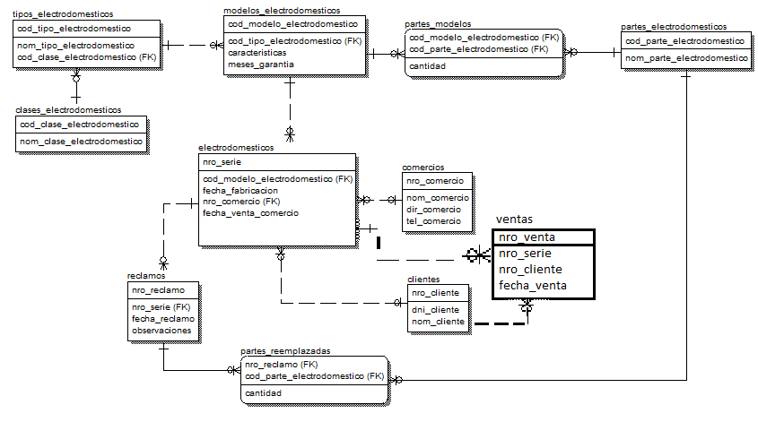

# Electrodomésticos: migrar el modelo sin perder datos


## El problema

Una empresa que fabrica electrodomésticos mantiene en una base de datos relacional sus productos, modelos, partes, comercios, clientes y reclamos. Para controlar mejor los reclamos, **solo se aceptan de quien figura como propietario del electrodoméstico**. Si un cliente se lo transfiere a otro, tiene que informar el traspaso para que el nuevo propietario pueda reclamar.

El modelo original solo permitía una venta al cliente por producto. Había que registrar los traspasos, y el modelo tenía que permitir saber quién puede reclamar según la fecha del reclamo.



## Restricciones que tuve en cuenta

* No podía borrar todo para hacer los cambios: se perdería la información que la base ya tiene.
* Tenía que llegar a la nueva estructura **paso a paso**, de modo que almacene lo nuevo y lo viejo.
* El orden de las operaciones es crítico: una columna con una regla de integridad no se puede eliminar, primero hay que eliminar la regla y después la columna.

## Cómo lo resolví

1. Creé la tabla `ventas`, que registra cada venta de un electrodoméstico: `nro_venta`, `nro_serie`, `nro_cliente` y `fecha_venta`.
2. Migré los datos: copié las ventas existentes de `electrodomesticos` a `ventas`, solo donde `nro_cliente` y `fecha_venta_cliente` no son nulos.
3. Eliminé las reglas de integridad de `electrodomesticos` que dependían de esas columnas.
4. Eliminé las columnas `nro_cliente` y `fecha_venta_cliente`, para no tener información redundante.
5. Agregué una nueva restricción para que `nro_comercio` y `fecha_venta_comercio` se manejen correctamente.

Además armé una consulta sobre el modelo original: **cantidad de partes utilizadas por año** para fabricar los electrodomésticos, con año, código de parte, nombre y cantidad.

## Contenido

```
01_modelo.sql                    Creación del modelo relacional (tablas, claves, restricciones)
02_migracion_ventas.sql          Migración a la tabla ventas, paso a paso
03_consulta_partes_por_anio.sql  Reporte de partes usadas por año de fabricación
```

Orden de ejecución: `01`, `02` y `03`.

## Técnicas usadas

`CREATE TABLE` con `PRIMARY KEY`, `FOREIGN KEY`, `UNIQUE` y `CHECK` · `INSERT ... SELECT` para migrar datos · `ALTER TABLE` para eliminar y volver a crear restricciones · `JOIN`, `GROUP BY` y `SUM` en el reporte.
