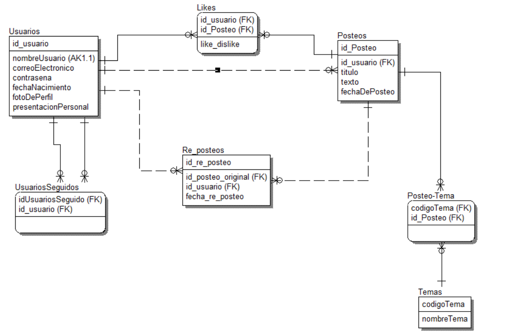

# Foro de posteos: diseño de la base de datos


Lo diseñamos junto con **Sabrina Valeria Vicente** y **Juana Ruiz Luque**.

## El problema

Una página web funciona como un foro: los usuarios pueden registrarse, publicar posteos, leer los de otros, darles like o dislike y entrar al perfil de otros usuarios para ver todo lo que publicaron. Había que diseñar la base de datos que sostiene todo eso.

## Cómo lo resolví

Empecé analizando los **procesos** y qué datos consulta o produce cada uno:

* **Registro de usuarios:** nombre de usuario, correo, contraseña, edad, foto de perfil y presentación personal.
* **Realización de posteos:** título, texto y usuario, con uno o varios temas asociados.
* **Interacción con posteos:** likes y dislikes, y cuántos recibió cada posteo.
* **Acceso a perfiles:** los posteos de cada usuario.

Después definí las **entidades**: Usuarios, Posteos, Temas, Posteo-Tema, Likes, Re-posteos y Usuarios seguidos.

## Relaciones

* Un usuario puede hacer varios posteos (uno a muchos).
* Un usuario puede seguir a uno, muchos o ningún otro usuario.
* Un posteo puede tener varios temas y un tema puede estar en varios posteos, resuelto con la entidad Posteo-Tema.
* Un usuario puede dar like o dislike **solo una vez por posteo**.
* Un usuario puede re-postear un solo posteo por vez.



## Contenido

```
diagrama-entidad-relacion.png   Diagrama entidad-relación
documentacion-diseno.pdf        Descripción de procesos, entidades y relaciones
```
